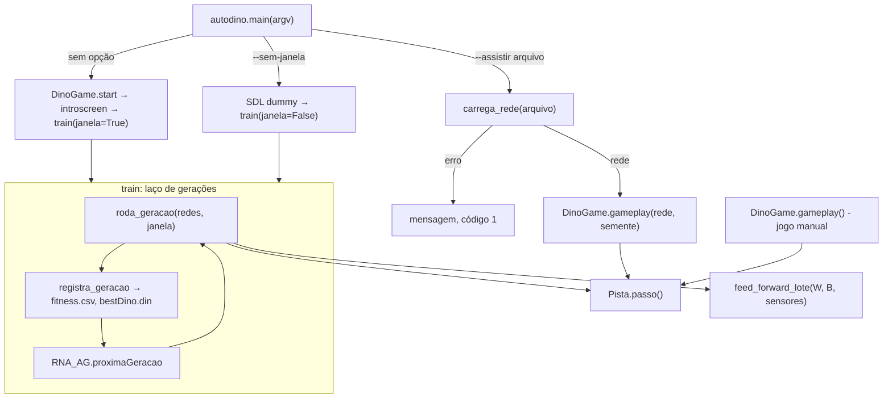

# Headless Training and Watch Design

**Spec**: `.specs/features/headless-training-and-watch/spec.md`
**Status**: Approved - 2026-11-22 - usuário: "Abordagem A. 2. Sim"

---

## Approaches Considered

Todas entregam o mesmo escopo da spec.

| | Abordagem | Prós | Contras |
|---|---|---|---|
| **A (recomendada)** | Extrair a pista para uma classe `Pista` dentro de `DinoGame.py`, usada pelo jogo manual, pelo treino e pelo modo assistir. O treino vira um laço de gerações com um parâmetro `janela`. Redes calculadas em lote e máscaras de colisão em cache | Uma só cópia das regras de obstáculo (TRACK-01 vale por construção). Os modos com e sem janela rodam a mesma simulação, o que sustenta HEAD-02. Os 25 testes existentes continuam válidos. Mudança incremental | `DinoGame.py` continua um arquivo grande |
| B | Reescrever a simulação em módulos novos (`simulacao.py` sem pygame, `render.py`, `treino.py`), com a física de todos os dinos em vetores numpy | A mais rápida e a mais limpa | Troca a colisão por pixel do pygame por outra implementação: risco de o treino divergir do jogo. Reescreve os testes existentes. Muito além do pedido |
| C | Manter os laços como estão e só pular o desenho com `if janela`, mais lote e cache | Menor diff | As regras de obstáculo ficariam copiadas em `gameplay` e em `train`: TRACK-01 dependeria de manter duas cópias iguais à mão |

## Architecture Overview

`autodino.py` interpreta as opções e chama um de três modos. Os três usam a mesma `Pista`. O treino roda o mesmo passo de simulação com e sem janela; a janela só acrescenta eventos, desenho e o limite de FPS.

**Onde as regras rodam**: criação de obstáculos (`Pista`), escolha do cacto do sensor (`cacto_a_frente`), decisão em lote (`RedeNeural`), validação do arquivo (`carrega_rede`) e opções (`autodino.main`) são funções ou classes de módulo, alcançadas por `test_ga.py` e pelo novo arquivo de testes sem abrir janela.

---

## Code Reuse Analysis

### Existing Components to Leverage

| Component | Location | How to Use |
| --------- | -------- | ---------- |
| `sensores(dino, cac, pte, gamespeed)` | `DinoGame.py` | Mantida; recebe o cacto já escolhido por `cacto_a_frente` |
| `Dino.agir`, `Dino.update` | `DinoGame.py` | Sem mudança; `agir` recebe a linha do lote |
| `remove_colididos` | `DinoGame.py` | Sem mudança; fica mais rápida porque os sprites passam a ter `.mask` |
| `registra_geracao` | `DinoGame.py` | Chamada pelo laço de gerações |
| `RNA_AG.iniciaPopulacao`, `proximaGeracao` | `AGMLP.py` | Sem mudança |
| `gameplay` (placar, fim de jogo, reinício) | `DinoGame.py` | Ganha os parâmetros `rede` e `semente`: com `rede`, a ação vem da rede e não do teclado. É o modo assistir |
| `RedeNeural.load_object` | `RedeNeural.py` | Usada por `carrega_rede` |
| `pygame.sprite.collide_mask` | pygame | Usa o atributo `.mask` do sprite quando ele existe; hoje refaz a máscara a cada chamada |

### Integration Points

| System | Integration Method |
| ------ | ------------------ |
| Testes existentes (`test_ga.py`) | Continuam chamando `train`, `sensores`, `registra_geracao`, `Cactus.__init__`, `iniciaPopulacao` e `disp_gameOver_msg`; o design mantém esses pontos e os atributos `DinoGame.train.currentGeneration`, `currentBest`, `recorde` |
| `fitness.csv`, `bestDino.din` | Mesmos formatos de `ga-training-fixes` |

---

## Components

### Pista

- **Purpose**: Dona dos obstáculos, das nuvens, do chão, da velocidade e do contador de frames; cria obstáculos pelas regras do jogo manual mais a distância mínima de 160 px.
- **Location**: `DinoGame.py`
- **Interfaces**:
  - `Pista()` - cria os grupos e registra `Cactus.containers`, `Ptera.containers`, `Cloud.containers`
  - `passo()` - um frame: cria obstáculos e nuvens, move tudo, soma 1 à velocidade a cada 700 frames
  - `desenha(screen)` - chão, nuvens, cactos e pteras
  - atributos `cacti`, `pteras`, `gamespeed`, `counter`
- **Dependencies**: `Cactus`, `Ptera`, `Cloud`, `Ground`, `random`
- **Reuses**: as regras de `gameplay` (`DinoGame.py:274-304`), com a troca: sem cacto na tela, o cacto novo só nasce se estiver a 160 px ou mais de todo obstáculo presente

### cacto_a_frente

- **Purpose**: Escolhe o cacto que o sensor mede.
- **Location**: `DinoGame.py`
- **Interfaces**: `cacto_a_frente(dino, cacti) -> Cactus | None` - o de menor `rect.left` entre os que têm `rect.right >= dino.rect.left`; `None` se todos passaram
- **Dependencies**: nenhuma
- **Reuses**: `sensores` já devolve `l = 1.0` para `None`

### Sprites e máscaras em cache

- **Purpose**: Carregar cada folha de sprites uma vez e dar a cada sprite uma máscara pronta.
- **Location**: `DinoGame.py`
- **Interfaces**: `Dino`, `Cactus` e `Ptera` ganham a propriedade `mask`, que devolve a máscara da imagem atual a partir de um cache
- **Dependencies**: `pygame.mask.from_surface`, `functools.lru_cache`
- **Reuses**: `DinoGame.load_sprite_sheet`

### Decisão em lote

- **Purpose**: Calcular a saída de todas as redes vivas em uma operação.
- **Location**: `RedeNeural.py`
- **Interfaces**:
  - `RedeNeural.empilha(redes) -> (W, B)` - listas por camada com os pesos `(N, y, x)` e bias `(N, y, 1)`
  - `RedeNeural.feed_forward_lote(W, B, a) -> ndarray (N, 2, 1)` - `a` tem forma `(N, 5, 1)`
- **Dependencies**: numpy
- **Reuses**: a mesma sigmoide de `feedForward`

### Geração e treino

- **Purpose**: Rodar uma geração e repetir por G gerações, sem recursão.
- **Location**: `DinoGame.py`
- **Interfaces**:
  - `DinoGame.roda_geracao(redes, janela) -> list[(score, rede)] | None` - simula até todos morrerem; com `janela`, trata eventos, desenha e limita o FPS; `None` se o usuário fechou
  - `DinoGame.train(nIndividuals, nGenerations, semente_base=0, saida=".", janela=True)` - semeia, cria a população, laço de gerações; sem janela imprime `Geração <g>: melhor=<score> media=<media>` e retorna ao fim; com janela mostra a tela de fim como hoje
- **Dependencies**: `Pista`, decisão em lote, `registra_geracao`, `RNA_AG`
- **Reuses**: o corpo atual de `train`; o parâmetro `population` sai junto com a recursão

### Assistir

- **Purpose**: Uma rede salva joga o jogo manual.
- **Location**: `DinoGame.py`
- **Interfaces**:
  - `carrega_rede(caminho) -> RedeNeural` - `FileNotFoundError` se o arquivo não existe; `ValueError` se não for uma `RedeNeural` de topologia `(5, 8, 4, 2)`
  - `DinoGame.gameplay(rede=None, semente=None)` - com `semente`, chama `random.seed(semente)` no início de cada partida
- **Dependencies**: `Pista`, `sensores`, `cacto_a_frente`, `Dino.agir`
- **Reuses**: placar, tela de fim de jogo e reinício de `gameplay`

### Linha de comando

- **Purpose**: Ponto de entrada dos três modos.
- **Location**: `autodino.py`
- **Interfaces**: `main(argv=None) -> int` - `argparse` com `--sem-janela` e `--assistir [arquivo]` mutuamente exclusivos, `--individuos`, `--geracoes`, `--semente`; define `SDL_VIDEODRIVER=dummy` antes de importar `DinoGame` quando `--sem-janela`
- **Dependencies**: `argparse`, `DinoGame`
- **Reuses**: `DinoGame.start` para o modo sem opções

---

## Error Handling Strategy

| Error Scenario | Handling | User Impact |
| -------------- | -------- | ----------- |
| `--assistir` com arquivo inexistente | `carrega_rede` levanta `FileNotFoundError`; `main` imprime e retorna 1 antes de criar a janela | `Arquivo não encontrado: <caminho>` |
| Arquivo que não é uma rede `(5, 8, 4, 2)` | `carrega_rede` levanta `ValueError`; `main` imprime e retorna 1 | `Arquivo inválido: <caminho>` |
| `--individuos` ou `--geracoes` menor que 1 | Tipo de argumento do `argparse` rejeita | Mensagem de uso, código 2 |
| `--sem-janela` com `--assistir` | Grupo mutuamente exclusivo do `argparse` | Mensagem de uso, código 2 |
| Treino sem janela interrompido (Ctrl+C) | Nada a fazer: `registra_geracao` já salvou a cada geração | `bestDino.din` com a melhor das gerações concluídas |

---

## Risks & Concerns

| Concern | Location (file:line) | Impact | Mitigation |
| ------- | -------------------- | ------ | ---------- |
| O critério HEAD-05 pedia razão 4 contra o treino com janela da mesma execução | `spec.md`, treino sem janela, critério 5 | Não atingível: a mudança também acelera o treino com janela (4,9 ms contra 1,3 ms, razão 3,7) | Resolvido com o usuário em 2026-11-22: critério passa a 1/2 na mesma execução, mais uma medição única de 1/4 contra o commit ad914bb |
| `train` tem 260 linhas e guarda estado em atributos da própria função | `DinoGame.py:381` | Difícil de testar e de mudar | `Pista` e `roda_geracao` tiram a simulação de dentro dele; os atributos ficam, porque o HUD e um teste existente os leem |
| Os testes existentes espionam pontos internos | `test_ga.py` (`Cactus.__init__`, `registra_geracao`, `disp_gameOver_msg`, `iniciaPopulacao`) | Uma reestruturação descuidada quebra testes que são a spec da feature anterior | O design mantém esses pontos de chamada; os 25 testes rodam no gate de toda tarefa |
| Resultado em lote pode diferir do cálculo por rede no último bit | `RedeNeural.py` | Uma decisão no limiar 0.5 poderia mudar | Os dois modos de treino usam o mesmo cálculo em lote, então HEAD-02 não depende disso; um teste compara lote e individual com tolerância |
| Teste de desempenho instável | novo teste de HEAD-05 | Falha por carga da máquina | Mede a mediana de vários frames, razão com folga sobre o valor medido |
| `pickle` executa código ao abrir | `RedeNeural.py` `load_object` | Abrir um `.din` de terceiros é inseguro | Fora do escopo, documentado na spec; `carrega_rede` só valida o tipo depois de abrir |
| Cada `Dino` carrega os sprites do disco | `DinoGame.py` `Dino.__init__` | 713 leituras de imagem por geração de 350 dinos | Cache das folhas de sprites |

---

## Tech Decisions (only non-obvious ones)

| Decision | Choice | Rationale |
| -------- | ------ | --------- |
| Nuvens na simulação sem janela | `Pista.passo` cria e move as nuvens nos dois modos | As nuvens consomem números de `random`; sem elas a sequência de obstáculos mudaria e HEAD-02 falharia |
| Modo assistir | Parâmetro `rede` em `gameplay`, não um laço novo | Reaproveita placar, fim de jogo e reinício; o jogo manual e o assistir ficam a mesma pista por construção |
| Máscaras | Propriedade `mask` nos sprites | `collide_mask` do pygame já a usa quando existe; nenhuma mudança no código de colisão |
| Eventos no treino sem janela | Não são lidos | Não há janela para fechar; a interrupção é por Ctrl+C |
| Pista única e sensor de cacto à frente | Registrado como AD-007 em `.specs/STATE.md` | Muda o ambiente de treino e o significado de uma entrada da rede para todas as features futuras |
